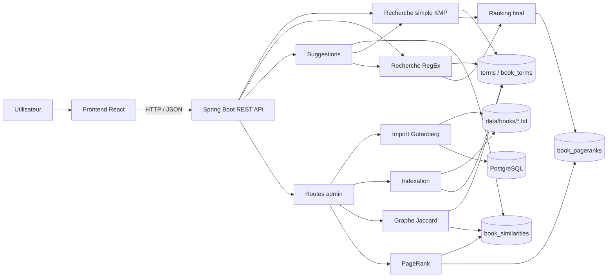

# DAAR Search Engine — Documentation backend exhaustive

> Référence technique du backend Spring Boot du moteur de recherche DAAR.
>
> Cette documentation décrit l'état fonctionnel du projet après les phases d'acquisition, d'indexation, de recherche KMP/RegEx, de graphe Jaccard, de PageRank, de ranking final et de recommandations.

## Sommaire

1. [Objectif et périmètre](#1-objectif-et-périmètre)
2. [Vue d'ensemble de l'architecture](#2-vue-densemble-de-larchitecture)
3. [Stack et organisation du code](#3-stack-et-organisation-du-code)
4. [Démarrage local](#4-démarrage-local)
5. [Modèle de données et migrations](#5-modèle-de-données-et-migrations)
6. [Pipeline complète](#6-pipeline-complète)
7. [Phase acquisition Gutenberg](#7-phase-acquisition-gutenberg)
8. [Phase indexation](#8-phase-indexation)
9. [Recherche simple KMP](#9-recherche-simple-kmp)
10. [Recherche avancée RegEx](#10-recherche-avancée-regex)
11. [Graphe de similarité Jaccard](#11-graphe-de-similarité-jaccard)
12. [PageRank pondéré](#12-pagerank-pondéré)
13. [Ranking final](#13-ranking-final)
14. [Suggestions et recommandations](#14-suggestions-et-recommandations)
15. [Référence exhaustive des routes HTTP](#15-référence-exhaustive-des-routes-http)
16. [Gestion des erreurs](#16-gestion-des-erreurs)
17. [Configuration](#17-configuration)
18. [Procédures d'exploitation](#18-procédures-dexploitation)
19. [Tests et validation](#19-tests-et-validation)
20. [Performances et passage à 1 664+ livres](#20-performances-et-passage-à-1-664-livres)
21. [Sécurité, CORS et limites actuelles](#21-sécurité-cors-et-limites-actuelles)
22. [Scénario de démonstration](#22-scénario-de-démonstration)
23. [Résultats de référence sur le corpus de développement](#23-résultats-de-référence-sur-le-corpus-de-développement)
24. [Glossaire](#24-glossaire)

---

## 1. Objectif et périmètre

Le backend construit un moteur de recherche sur une bibliothèque de livres Project Gutenberg. La cible du projet est un corpus d'au moins **1 664 livres**, chaque livre conservé devant contenir au moins **10 000 mots**.

Le backend couvre actuellement toute la chaîne principale :

- acquisition et stockage local des textes Gutenberg ;
- index inversé `terms` / `book_terms` ;
- recherche simple avec l'algorithme **KMP** du projet 1 ;
- recherche avancée avec la chaîne **RegEx → arbre syntaxique → NFA → DFA → minimisation Hopcroft** ;
- calcul d'un graphe de similarité **Jaccard** entre livres ;
- calcul de centralité **PageRank pondéré** sur ce graphe ;
- ranking final combinant pertinence lexicale et PageRank ;
- suggestions basées sur les voisins Jaccard des meilleurs résultats.

État des phases :

| Phase | Fonctionnalité | État |
|---|---|---|
| 0 | Infrastructure Spring Boot / PostgreSQL / Flyway / CORS | ✅ |
| 1 | Réutilisation des algorithmes du projet 1 | ✅ |
| 2 | Acquisition et stockage Gutenberg | ✅ |
| 3 | Indexation `terms` / `book_terms` | ✅ |
| 4 | Recherche simple KMP | ✅ |
| 5 | Recherche avancée RegEx | ✅ |
| 6 | Graphe Jaccard | ✅ |
| 7 | PageRank + ranking final | ✅ |
| 8 | Suggestions / recommandations | ✅ |

---

## 2. Vue d'ensemble de l'architecture



La séparation importante est la suivante :

- **la recherche** identifie les livres pertinents ;
- **le ranking** classe ces livres ;
- **le graphe** modélise les relations entre livres ;
- **les suggestions** utilisent ce graphe en complément de la recherche.

---

## 3. Stack et organisation du code

### 3.1 Stack

- Java 21 cible de compilation ;
- Spring Boot 4.1.x ;
- Spring Web MVC ;
- Spring Data JPA pour les entités simples ;
- Spring JDBC / `JdbcTemplate` pour les opérations d'index et de graphe ;
- PostgreSQL 16 ;
- Flyway pour versionner le schéma ;
- Maven ;
- JUnit 5 ;
- Mockito pour certains tests de services.

### 3.2 Packages principaux

```text
com.sorbonne
├── automata/                 # automates du projet 1
├── regex/                    # parser RegEx, NFA, DFA, minimisation
├── search/                   # KMP, NativeSearch, PreparedSearch
└── backend/
    ├── book/                 # métadonnées des livres
    ├── config/               # CORS, stockage
    ├── gutenberg/            # acquisition Gutenberg
    ├── health/               # health check
    ├── indexing/             # index inversé
    ├── search/               # recherche simple / avancée
    ├── similarity/           # graphe Jaccard
    ├── ranking/              # PageRank + ranking final
    └── recommendation/       # suggestions
```

### 3.3 Principe de persistance

Hibernate est configuré en :

```yaml
spring:
  jpa:
    hibernate:
      ddl-auto: validate
```

Hibernate **ne crée pas** le schéma. Flyway est la source de vérité pour la structure SQL ; Hibernate vérifie seulement la cohérence entre schéma et entités.

---

## 4. Démarrage local

### 4.1 Prérequis

- PostgreSQL démarré ;
- base créée ;
- Java installé ;
- Maven installé ou Maven Wrapper disponible ;
- variable `DB_PASSWORD` définie.

Exemple :

```bash
export DB_PASSWORD='votre_mot_de_passe_local'
cd backend
mvn spring-boot:run
```

Par défaut :

```text
API : http://localhost:8080
DB  : jdbc:postgresql://localhost:5432/idrisdatabase
```

Le nom de la base et l'utilisateur sont surchargeables via variables d'environnement.

### 4.2 Vérification

```bash
curl http://localhost:8080/api/health
```

Réponse :

```json
{
  "status": "UP"
}
```

---

## 5. Modèle de données et migrations

### 5.1 V1 — couche data

Tables créées :

#### `books`

Métadonnées et état d'un livre.

Champs principaux :

- `id` : identifiant interne ;
- `gutenberg_id` : identifiant Project Gutenberg, unique ;
- `title` ;
- `author` ;
- `language` ;
- `word_count` ;
- `storage_key` après migration V2 ;
- `source_url` ;
- `content_sha256` ;
- `content_bytes` ;
- `status` ;
- `created_at`, `updated_at`.

États possibles :

```text
READY
REJECTED_TOO_SHORT
FAILED
```

#### `terms`

Dictionnaire global de l'index.

- `id` ;
- `value` unique ;
- `document_frequency` : nombre de livres contenant le terme.

#### `book_terms`

Posting list entre livres et termes.

- `book_id` ;
- `term_id` ;
- `occurrences` : nombre d'occurrences du terme dans ce livre.

Une contrainte garantit une seule ligne `(book_id, term_id)`.

#### `gutenberg_import_checkpoint`

Permet de reprendre un import Gutenberg interrompu :

- source ;
- URL de page courante ;
- position du prochain lien ;
- date de mise à jour.

### 5.2 V2 — stockage portable

La migration V2 remplace l'ancien chemin absolu `local_path` par :

```text
storage_key
```

Exemple :

```text
10084.txt
```

La base ne contient donc pas :

```text
/Users/alice/projet/backend/data/books/10084.txt
```

Le chemin machine est reconstruit localement à partir de `app.storage.books-root`.

### 5.3 V3 — graphe Jaccard

Table :

```text
book_similarities
```

Chaque ligne représente une arête non orientée stockée une seule fois avec :

```text
book_a_id < book_b_id
```

Champs :

- `book_a_id` ;
- `book_b_id` ;
- `jaccard_score` ;
- `intersection_size` ;
- `union_size` ;
- `created_at`.

### 5.4 V4 — PageRank

#### `book_pageranks`

- `book_id` ;
- `score` ;
- `computed_at`.

#### `pagerank_state`

Singleton `id = 1` décrivant le dernier calcul :

- date ;
- damping factor ;
- tolérance ;
- nombre maximal d'itérations ;
- nombre d'itérations réalisées ;
- convergence ;
- delta final ;
- nombre de nœuds ;
- nombre d'arêtes.

---

## 6. Pipeline complète

Ordre normal de construction d'un corpus :

```text
1. Import Gutenberg
        ↓
2. Fichiers UTF-8 + métadonnées books
        ↓
3. Indexation
        ↓
4. terms + book_terms
        ↓
5. Recherche KMP / RegEx possible
        ↓
6. Rebuild graphe Jaccard
        ↓
7. book_similarities
        ↓
8. Rebuild PageRank
        ↓
9. book_pageranks
        ↓
10. Ranking final lexical + PageRank
        ↓
11. Suggestions via voisins Jaccard
```

### Dépendances importantes

- une recherche nécessite un index ;
- Jaccard nécessite au moins deux livres `READY` indexés ;
- PageRank nécessite les livres `READY` et exploite les arêtes Jaccard existantes ;
- si le graphe Jaccard est reconstruit, le PageRank précédent devient périmé ;
- les suggestions de recherche utilisent le ranking actuel et le graphe Jaccard.

---

## 7. Phase acquisition Gutenberg

### 7.1 Source d'import massif

L'import de masse utilise le mécanisme de harvest Gutenberg :

```text
https://www.gutenberg.org/robot/harvest?filetypes[]=txt&langs[]=en
```

RapidAPI est conservé pour la consultation/probe, pas pour télécharger 1 664 textes individuellement.

### 7.2 Traitement d'un livre

Pour chaque archive :

```text
lien harvest
   ↓
téléchargement ZIP
   ↓
lecture du .txt
   ↓
décodage UTF-8, fallback ISO-8859-1
   ↓
extraction métadonnées Title / Author / Language
   ↓
suppression du boilerplate Gutenberg si marqueurs trouvés
   ↓
comptage des mots
   ↓
>= 10 000 ?
   ├── oui → stockage UTF-8 + READY
   └── non → REJECTED_TOO_SHORT
```

En cas d'erreur de traitement :

```text
FAILED
```

### 7.3 Stockage local

Chemin par défaut :

```text
backend/data/books/<gutenbergId>.txt
```

La sauvegarde utilise un fichier temporaire puis un déplacement atomique lorsque le système le permet.

Pour chaque fichier conservé, on stocke également :

- SHA-256 ;
- taille en octets ;
- nombre de mots ;
- URL source.

### 7.4 Sécurité du `storage_key`

Un `storage_key` :

- doit être relatif ;
- ne peut pas sortir du dossier racine avec `../` ;
- est résolu uniquement côté backend.

### 7.5 Reprise d'import

`gutenberg_import_checkpoint` mémorise le prochain emplacement à traiter. L'import peut donc être exécuté en lots successifs sans repartir du début.

### 7.6 Cas particulier aleph.gutenberg.org

Le client ne désactive jamais TLS globalement. En cas de mismatch de certificat spécifiquement sur :

```text
https://aleph.gutenberg.org
```

il peut retenter l'archive officielle en HTTP. Le fallback est volontairement limité à cet hôte.

---

## 8. Phase indexation

### 8.1 Normalisation

Tous les textes passent par `TextNormalizer`.

Principes :

- minuscules ;
- suppression des accents ;
- normalisation de certaines ponctuations Unicode ;
- alphabet de sortie compatible avec le moteur de recherche du projet 1 ;
- apostrophe et tiret conservés seulement à l'intérieur d'un mot.

Exemples :

```text
Café            → cafe
L’Homme          → l'homme
Jean—Paul        → jean-paul
Straße           → strasse
Œuvre            → oeuvre
```

Pattern de tokenisation :

```text
[a-z]+(?:['-][a-z]+)*
```

### 8.2 Comptage

Pour un livre :

```text
texte
  ↓
tokens normalisés
  ↓
Map<term, occurrences>
```

Exemple conceptuel :

```text
man → 42
woman → 13
forest → 31
```

### 8.3 Écriture de l'index

Le worker :

1. vérifie que le livre existe ;
2. vérifie qu'il est `READY` ;
3. résout le fichier via `storage_key` ;
4. lit le texte ;
5. calcule les fréquences ;
6. supprime les anciennes lignes `book_terms` du livre ;
7. insère les termes absents ;
8. insère les postings ;
9. recalcule `document_frequency` pour les termes affectés ;
10. supprime les termes devenus orphelins.

La réindexation d'un livre est donc **idempotente**.

### 8.4 Pourquoi JDBC

Les insertions sont réalisées en batch avec `JdbcTemplate` plutôt qu'avec une entité JPA par occurrence. Cela réduit fortement l'overhead pour des milliers de termes par livre.

---

## 9. Recherche simple KMP

### 9.1 Sémantique

La recherche simple accepte **exactement un mot-clé**.

Exemple :

```text
q = man
```

Le mot est normalisé puis recherché comme **sous-chaîne** dans chaque terme du dictionnaire.

Donc `man` peut matcher :

```text
man
mankind
woman
gentleman
```

### 9.2 Algorithme

Le moteur utilise l'implémentation KMP du projet 1 :

```java
PreparedSearch prepared = KMPSearch.prepare(normalizedQuery);
prepared.search(term.value());
```

Le pattern KMP est préparé **une seule fois par requête**, puis réutilisé sur tous les termes indexés.

### 9.3 Pipeline

```text
q
↓
TextNormalizer
↓
KMPSearch.prepare(q)
↓
scan du dictionnaire terms en Java
↓
IDs des termes matchés
↓
book_terms
↓
agrégation occurrences par livre
↓
ranking final
↓
pagination
```

PostgreSQL n'effectue pas la recherche par `LIKE '%...%'` dans le code applicatif.

### 9.4 Score lexical

Pour un livre `b` :

```text
lexicalScore(b) = somme des occurrences
                  de tous les termes matchés dans b
```

Exemple :

```text
man       : 10
mankind   : 2
gentleman : 4

lexicalScore = 16
matchedTerms = 3
```

---

## 10. Recherche avancée RegEx

### 10.1 Pipeline algorithmique exact

```text
RegEx entrée
   ↓
normalisation casse + accents
   ↓
RegexParser.parse
   ↓
SyntaxTree
   ↓
NFA.buildNFA
   ↓
DFA.forSearch
   ↓
DFAM.minimize
   ↓
DFA minimal Hopcroft
   ↓
NativeSearch.fromSearchDfa
   ↓
scan des termes indexés
```

Le DFA construit par `DFA.forSearch` est un automate de **recherche de sous-chaîne**, pas uniquement de reconnaissance du mot entier.

### 10.2 Opérateurs supportés

Supportés :

```text
concaténation implicite
*
.
|
(...)
```

Exemples :

```text
m(an|en)
w.*f
c(a|o)t
(man|woman)
```

Échappements littéraux supportés :

```text
\.
\*
\|
\(
\)
\\
```

Non supportés :

```text
+
?
[]
{}
^
$
```

### 10.3 Contraintes

- motif non vide ;
- longueur maximale : **256 caractères** ;
- alphabet ASCII après normalisation ;
- erreur 400 si syntaxe invalide.

### 10.4 Observabilité de l'automate

La réponse expose :

```text
nfaStates
dfaStates
minimizedDfaStates
```

Cela permet de montrer directement l'effet de la déterminisation et de la minimisation pendant la démonstration.

---

## 11. Graphe de similarité Jaccard

### 11.1 Représentation

Chaque livre `READY` indexé est un nœud.

Une arête entre `A` et `B` signifie que les deux livres partagent suffisamment de termes discriminants.

### 11.2 Features utilisées

Le graphe ne prend pas tous les termes bruts.

Un terme doit respecter notamment :

- `document_frequency >= 2` ;
- longueur minimale configurable ;
- fréquence documentaire maximale adaptative ;
- ne pas appartenir à la liste de stopwords ;
- les deux livres doivent partager au moins un nombre minimal de features.

Valeurs par défaut :

```text
min DF                = 2
max DF ratio          = 10 %
minimum max DF        = 3
max DF absolu         = 200
longueur min terme    = 3
termes partagés min   = 2
Jaccard minimum       = 0.05
sélection top locale  = 20
```

Le plafond de DF est :

```text
min(maxAbsolute, max(minimumMaxDf, ceil(indexedBooks × ratio)))
```

Exemple avec 5 livres :

```text
ceil(5 × 0.10) = 1
max(3, 1) = 3
→ maxDocumentFrequency = 3
```

### 11.3 Formule

Chaque livre est représenté par l'ensemble de ses termes éligibles.

```text
J(A,B) = |A ∩ B| / |A ∪ B|
```

avec :

```text
|A ∪ B| = |A| + |B| - |A ∩ B|
```

Les occurrences ne pondèrent pas Jaccard : on compare ici la présence de features.

### 11.4 Optimisation par index inversé

Le backend ne compare pas naïvement le texte de chaque livre avec tous les autres.

La requête SQL joint les postings d'un même `term_id` :

```text
term → liste de livres
```

et produit uniquement les paires partageant réellement des termes.

### 11.5 Graphe sparse

Pour chaque nœud, le builder retient localement ses meilleures arêtes selon le score Jaccard, puis prend l'union des arêtes sélectionnées.

Cela maintient le graphe exploitable pour PageRank sur un corpus beaucoup plus grand.

> Remarque : `max-neighbors-per-book` est une limite de sélection locale. Après union des sélections des différents nœuds, le degré final d'un nœud peut théoriquement dépasser cette valeur si beaucoup d'autres livres le sélectionnent.

---

## 12. PageRank pondéré

### 12.1 Entrée

- nœuds : tous les livres `READY` ;
- arêtes : `book_similarities` ;
- poids : `jaccard_score`.

Le graphe Jaccard étant non orienté, chaque arête est utilisée dans les deux sens pendant PageRank.

### 12.2 Formule

Pour un nœud `v` :

```text
PR(v) = (1-d)/N
        + d × Σ [ PR(u) × w(u,v) / Σ_k w(u,k) ]
```

avec :

```text
d = 0.85 par défaut
```

### 12.3 Nœuds sans arête

La masse PageRank des nœuds pendants est redistribuée uniformément :

```text
danglingContribution = d × danglingMass / N
```

### 12.4 Convergence

Initialisation :

```text
PR_i = 1 / N
```

À chaque itération :

```text
delta = Σ |PR_new(i) - PR_old(i)|
```

Arrêt si :

```text
delta <= tolerance
```

ou si `maxIterations` est atteint.

Valeurs par défaut :

```text
dampingFactor = 0.85
tolerance     = 1e-10
maxIterations = 200
```

### 12.5 Persistance et fraîcheur

Après un calcul :

- un score par livre est enregistré dans `book_pageranks` ;
- les métadonnées du run sont enregistrées dans `pagerank_state`.

Un PageRank est considéré courant seulement si :

1. un état de run existe ;
2. le nombre de scores correspond au nombre de livres `READY` ;
3. `node_count` correspond également au nombre de livres `READY` ;
4. le graphe Jaccard n'a pas été reconstruit après le PageRank.

---

## 13. Ranking final

### 13.1 Pourquoi normaliser

Les deux valeurs sont sur des échelles incompatibles :

```text
lexicalScore : centaines / milliers possibles
PageRank     : probabilité, souvent << 1
```

On normalise donc les deux.

### 13.2 Score lexical normalisé

Pour les candidats de la requête :

```text
normalizedLexicalScore(b)
= lexicalScore(b) / maxLexicalScoreDeLaRequête
```

### 13.3 PageRank normalisé

Par rapport au meilleur PageRank du corpus :

```text
normalizedPageRankScore(b)
= pageRank(b) / maxPageRankDuCorpus
```

### 13.4 Formule finale

Par défaut :

```text
finalScore = 0.85 × normalizedLexicalScore
           + 0.15 × normalizedPageRankScore
```

Les poids sont configurables et renormalisés pour que leur somme soit 1.

### 13.5 Fallback automatique

Si PageRank est absent ou périmé :

```text
pageRankApplied = false
lexicalWeight   = 1.0
pageRankWeight  = 0.0
```

Le moteur continue donc à fonctionner avec le ranking lexical seul.

### 13.6 Ordre de tri final

Les résultats sont triés par :

1. `finalScore` décroissant ;
2. `lexicalScore` décroissant ;
3. `matchedTerms` décroissant ;
4. titre alphabétique ;
5. `bookId`.

---

## 14. Suggestions et recommandations

### 14.1 Suggestions issues d'une recherche

Pour une recherche simple ou avancée :

```text
résultats classés
      ↓
top N = graines
      ↓
poids des graines
      ↓
voisins Jaccard
      ↓
exclusion des graines
      ↓
agrégation des contributions
      ↓
suggestions triées
```

Valeur par défaut :

```text
3 graines
```

### 14.2 Poids d'une graine

Si les `finalScore` sont positifs :

```text
seedWeight_i = finalScore_i / Σ finalScore_j
```

Si tous les scores sont nuls :

```text
seedWeight_i = 1 / nombreDeGraines
```

### 14.3 Contribution

Pour une graine `s` et un candidat `c` :

```text
contribution(s,c)
= seedWeight(s) × Jaccard(s,c)
```

Score final de recommandation :

```text
recommendationScore(c)
= Σ_s contribution(s,c)
```

### 14.4 Explicabilité

Chaque suggestion expose :

- score final de recommandation ;
- meilleur Jaccard observé ;
- nombre de graines qui la soutiennent ;
- détail des contributions par graine.

### 14.5 Tri

Ordre :

1. `recommendationScore` décroissant ;
2. `bestJaccardScore` décroissant ;
3. `supportingSeeds` décroissant ;
4. titre ;
5. id.

### 14.6 Suggestions directes d'un livre

`GET /api/books/{id}/suggestions` ne repasse pas par une recherche. Il retourne directement les voisins Jaccard du livre, triés par similarité.

---

# 15. Référence exhaustive des routes HTTP

## 15.1 Conventions générales

Base URL locale :

```text
http://localhost:8080
```

Pagination :

```text
page commence à 0
size est borné à 100 pour les recherches et la liste des livres
```

Les durées `elapsedMillis` sont indicatives et dépendent du corpus et de la machine.

---

## 15.2 Health

### `GET /api/health`

But : vérifier que l'application répond.

```bash
curl http://localhost:8080/api/health
```

Réponse `200` :

```json
{
  "status": "UP"
}
```

---

## 15.3 Livres

### `GET /api/books`

Liste uniquement les livres `READY`.

Paramètres :

| Nom | Défaut | Règle |
|---|---:|---|
| `page` | `0` | valeurs négatives ramenées à 0 |
| `size` | `20` | borné entre 1 et 100 |

Exemple :

```bash
curl "http://localhost:8080/api/books?page=0&size=20"
```

Chaque entrée `content` :

```json
{
  "id": 6,
  "gutenbergId": 10084,
  "title": "Kazan",
  "author": "James Oliver Curwood",
  "language": "en",
  "wordCount": 69489,
  "status": "READY"
}
```

La réponse externe est un `Page<BookResponse>` Spring et contient également les métadonnées de pagination standard (`totalElements`, `totalPages`, numéro de page, taille, etc.).

### `GET /api/books/{id}`

Retourne un livre `READY`.

```bash
curl http://localhost:8080/api/books/6
```

Réponse `200` : même schéma `BookResponse` ci-dessus.

Réponse `404` si l'id n'existe pas ou si le livre n'est pas `READY`.

---

## 15.4 Import Gutenberg

### `GET /api/admin/gutenberg/import/status`

Retourne l'état de l'import.

```bash
curl http://localhost:8080/api/admin/gutenberg/import/status
```

Schéma :

```json
{
  "readyBooks": 5,
  "rejectedTooShort": 0,
  "failed": 0,
  "nextPageUrl": "https://...",
  "nextLinkIndex": 5,
  "minimumWordCount": 10000
}
```

### `POST /api/admin/gutenberg/import/batch`

Paramètres :

| Nom | Défaut | Règle |
|---|---:|---|
| `target` | `1664` | >= 1 |
| `maxDownloads` | `10` | entre 1 et 100 |

Exemple :

```bash
curl -X POST "http://localhost:8080/api/admin/gutenberg/import/batch?target=1664&maxDownloads=10"
```

Réponse :

```json
{
  "targetReadyBooks": 1664,
  "readyBefore": 5,
  "readyAfter": 13,
  "attemptedDownloads": 10,
  "accepted": 8,
  "rejectedTooShort": 1,
  "failed": 1,
  "skippedExisting": 0,
  "nextPageUrl": "https://...",
  "nextLinkIndex": 15,
  "minimumWordCount": 10000
}
```

Les valeurs sont représentatives ; elles dépendent du lot traité.

### `GET /api/admin/gutenberg/rapidapi/quota`

Retourne le dernier snapshot de quota RapidAPI connu.

Aucun snapshot n'existe tant qu'aucun appel RapidAPI n'a été observé depuis le démarrage.

Après un appel, schéma :

```json
{
  "planLimit": 1000,
  "planRemaining": 950,
  "planResetSeconds": 12345,
  "hardLimit": null,
  "hardRemaining": null,
  "hardResetSeconds": null,
  "observedAt": "2026-10-17T20:00:00Z"
}
```

Les headers disponibles dépendent du plan RapidAPI ; certains champs peuvent être `null`.

### `POST /api/admin/gutenberg/rapidapi/probe`

> Cette route consomme une requête RapidAPI.

Paramètres :

| Nom | Défaut | Règle |
|---|---:|---|
| `page` | `1` | minimum effectif 1 |
| `pageSize` | `10` | borné entre 1 et 100 |
| `query` | absent | optionnel |

Exemple :

```bash
curl -X POST "http://localhost:8080/api/admin/gutenberg/rapidapi/probe?page=1&pageSize=10"
```

Structure :

```json
{
  "body": {
    "next": "...",
    "previous": null,
    "results": [
      {
        "id": 123,
        "title": "...",
        "alternativeTitle": null,
        "authors": [],
        "subjects": [],
        "bookshelves": [],
        "mediaType": "Text",
        "downloadCount": 100,
        "issued": "...",
        "readingEaseScore": null,
        "coverImage": "...",
        "language": "en"
      }
    ]
  },
  "quota": {
    "planLimit": 1000,
    "planRemaining": 999,
    "planResetSeconds": 1000,
    "hardLimit": null,
    "hardRemaining": null,
    "hardResetSeconds": null,
    "observedAt": "2026-10-17T20:00:00Z"
  }
}
```

---

## 15.5 Indexation

### `GET /api/admin/indexing/status`

```bash
curl http://localhost:8080/api/admin/indexing/status
```

Exemple validé sur le corpus de développement :

```json
{
  "readyBooks": 5,
  "indexedBooks": 5,
  "unindexedBooks": 0,
  "terms": 13671,
  "bookTerms": 26160
}
```

### `POST /api/admin/indexing/books/{bookId}`

Force/reconstruit l'index d'un livre.

```bash
curl -X POST http://localhost:8080/api/admin/indexing/books/6
```

Réponse :

```json
{
  "bookId": 6,
  "gutenbergId": 10084,
  "storageKey": "10084.txt",
  "uniqueTerms": 5442,
  "totalTokens": 69489,
  "elapsedMillis": 401
}
```

Erreurs possibles :

- `404` livre absent ;
- `400` livre non `READY` ;
- `409` problème de fichier / index incohérent.

### `POST /api/admin/indexing/all`

Indexe uniquement les livres `READY` qui n'ont encore aucune ligne `book_terms`.

Paramètre :

| Nom | Défaut | Règle |
|---|---:|---|
| `maxBooks` | `50` | entre 1 et 2000 |

```bash
curl -X POST "http://localhost:8080/api/admin/indexing/all?maxBooks=50"
```

Réponse :

```json
{
  "attempted": 5,
  "indexed": 5,
  "failed": 0,
  "books": [
    {
      "bookId": 6,
      "gutenbergId": 10084,
      "storageKey": "10084.txt",
      "uniqueTerms": 5442,
      "totalTokens": 69489,
      "elapsedMillis": 401
    }
  ],
  "failures": [],
  "elapsedMillis": 1308
}
```

Une erreur sur un livre ne rollback pas les livres déjà indexés dans le batch : chaque livre passe dans sa propre transaction worker.

---

## 15.6 Recherche simple KMP

### `GET /api/search`

Paramètres :

| Nom | Défaut | Règle |
|---|---:|---|
| `q` | obligatoire | exactement un mot-clé après tokenisation |
| `page` | `0` | minimum effectif 0 |
| `size` | `20` | borné entre 1 et 100 |

```bash
curl "http://localhost:8080/api/search?q=man&page=0&size=20"
```

Exemple réel après calcul PageRank :

```json
{
  "query": "man",
  "normalizedQuery": "man",
  "page": 0,
  "size": 20,
  "totalElements": 5,
  "totalPages": 1,
  "matchedIndexTerms": 112,
  "pageRankApplied": true,
  "lexicalWeight": 0.85,
  "pageRankWeight": 0.15,
  "elapsedMillis": 36,
  "content": [
    {
      "bookId": 10,
      "gutenbergId": 1720,
      "title": "The Man Who Knew Too Much",
      "author": "G.K. Chesterton",
      "language": "en",
      "wordCount": 62794,
      "lexicalScore": 497,
      "matchedTerms": 59,
      "normalizedLexicalScore": 1.0,
      "pageRankScore": 0.23931536823167612,
      "normalizedPageRankScore": 1.0,
      "finalScore": 1.0
    }
  ]
}
```

Signification :

| Champ | Signification |
|---|---|
| `matchedIndexTerms` | nombre de termes du dictionnaire matchant KMP |
| `lexicalScore` | somme des occurrences de ces termes dans le livre |
| `matchedTerms` | nombre de termes matchés présents dans ce livre |
| `normalizedLexicalScore` | lexical / meilleur lexical de la requête |
| `pageRankScore` | PageRank brut du livre |
| `normalizedPageRankScore` | PageRank / meilleur PageRank du corpus |
| `finalScore` | combinaison pondérée finale |

Erreur exemple :

```bash
curl --get "http://localhost:8080/api/search" --data-urlencode "q=the man"
```

```json
{
  "error": "Simple search accepts exactly one keyword"
}
```

---

## 15.7 Recherche avancée RegEx

### `GET /api/search/advanced`

Paramètres :

| Nom | Défaut | Règle |
|---|---:|---|
| `regex` | obligatoire | motif supporté, <= 256 caractères |
| `page` | `0` | minimum effectif 0 |
| `size` | `20` | borné entre 1 et 100 |

Exemple :

```bash
curl --get "http://localhost:8080/api/search/advanced" \
  --data-urlencode "regex=m(an|en)" \
  --data-urlencode "page=0" \
  --data-urlencode "size=20"
```

Exemple réel :

```json
{
  "regex": "m(an|en)",
  "normalizedRegex": "m(an|en)",
  "page": 0,
  "size": 20,
  "totalElements": 5,
  "totalPages": 1,
  "matchedIndexTerms": 275,
  "nfaStates": 12,
  "dfaStates": 5,
  "minimizedDfaStates": 4,
  "pageRankApplied": true,
  "lexicalWeight": 0.85,
  "pageRankWeight": 0.15,
  "elapsedMillis": 42,
  "content": [
    {
      "bookId": 10,
      "gutenbergId": 1720,
      "title": "The Man Who Knew Too Much",
      "author": "G.K. Chesterton",
      "language": "en",
      "wordCount": 62794,
      "lexicalScore": 832,
      "matchedTerms": 147,
      "normalizedLexicalScore": 1.0,
      "pageRankScore": 0.23931536823167612,
      "normalizedPageRankScore": 1.0,
      "finalScore": 1.0
    }
  ]
}
```

Erreur motif non supporté :

```bash
curl --get "http://localhost:8080/api/search/advanced" --data-urlencode "regex=man+"
```

Réponse `400` :

```json
{
  "error": "Invalid regex: Operateur ERE non pris en charge : +"
}
```

---

## 15.8 Graphe Jaccard

### `GET /api/admin/similarity/status`

```bash
curl http://localhost:8080/api/admin/similarity/status
```

Exemple réel :

```json
{
  "readyBooks": 5,
  "indexedBooks": 5,
  "storedEdges": 10,
  "lastBuiltAt": "2026-10-17T20:50:43.233583Z",
  "minDocumentFrequency": 2,
  "maxDocumentFrequencyRatio": 0.1,
  "minimumSimilarity": 0.05,
  "maxNeighborsPerBook": 20
}
```

Avant le premier rebuild, `storedEdges` vaut 0 et `lastBuiltAt` vaut `null`.

### `POST /api/admin/similarity/rebuild`

```bash
curl -X POST http://localhost:8080/api/admin/similarity/rebuild
```

Exemple réel :

```json
{
  "readyBooks": 5,
  "indexedBooks": 5,
  "maxDocumentFrequency": 3,
  "eligibleTerms": 3630,
  "featurePostings": 8481,
  "candidatePairs": 10,
  "qualifyingPairs": 10,
  "storedEdges": 10,
  "minimumSimilarity": 0.05,
  "maxNeighborsPerBook": 20,
  "elapsedMillis": 152
}
```

Précondition : au moins deux livres `READY` indexés.

### `GET /api/admin/similarity/books/{bookId}/neighbors`

Paramètre :

| Nom | Défaut | Règle |
|---|---:|---|
| `limit` | `10` | entre 1 et 100 |

```bash
curl "http://localhost:8080/api/admin/similarity/books/6/neighbors?limit=10"
```

Exemple réel :

```json
{
  "bookId": 6,
  "neighbors": [
    {
      "bookId": 10,
      "gutenbergId": 1720,
      "title": "The Man Who Knew Too Much",
      "author": "G.K. Chesterton",
      "jaccardScore": 0.3202170963364993,
      "intersectionSize": 944,
      "unionSize": 2948
    }
  ]
}
```

---

## 15.9 PageRank

### `GET /api/admin/ranking/pagerank/status`

```bash
curl http://localhost:8080/api/admin/ranking/pagerank/status
```

Avant calcul :

```json
{
  "readyBooks": 5,
  "similarityEdges": 10,
  "storedScores": 0,
  "available": false,
  "stale": true,
  "computedAt": null,
  "similarityBuiltAt": "2026-10-17T20:50:43.233583Z",
  "dampingFactor": 0.85,
  "tolerance": 1.0E-10,
  "maxIterations": 200,
  "iterations": null,
  "converged": null,
  "finalDelta": null,
  "lexicalWeight": 0.85,
  "pageRankWeight": 0.15
}
```

### `POST /api/admin/ranking/pagerank/rebuild`

```bash
curl -X POST http://localhost:8080/api/admin/ranking/pagerank/rebuild
```

Exemple réel :

```json
{
  "nodeCount": 5,
  "edgeCount": 10,
  "dampingFactor": 0.85,
  "tolerance": 1.0E-10,
  "maxIterations": 200,
  "iterations": 19,
  "converged": true,
  "finalDelta": 5.830091964753592E-11,
  "scoreSum": 1.0000000000000002,
  "minScore": 0.15059021689852076,
  "maxScore": 0.23931536823167612,
  "elapsedMillis": 28
}
```

`scoreSum` doit rester numériquement très proche de 1.

### `GET /api/admin/ranking/pagerank/top`

Paramètre :

| Nom | Défaut | Règle |
|---|---:|---|
| `limit` | `20` | entre 1 et 100 |

```bash
curl "http://localhost:8080/api/admin/ranking/pagerank/top?limit=10"
```

Exemple réel :

```json
{
  "books": [
    {
      "bookId": 10,
      "gutenbergId": 1720,
      "title": "The Man Who Knew Too Much",
      "author": "G.K. Chesterton",
      "pageRankScore": 0.23931536823167612
    },
    {
      "bookId": 8,
      "gutenbergId": 1898,
      "title": "Albert Savarus",
      "author": "Honore de Balzac",
      "pageRankScore": 0.2257498725328979
    }
  ]
}
```

---

## 15.10 Suggestions depuis une recherche simple

### `GET /api/search/suggestions`

Paramètres :

| Nom | Défaut | Règle |
|---|---:|---|
| `q` | obligatoire | mêmes règles que recherche simple |
| `seedCount` | `3` | entre 1 et `maxSeedCount` (5 par défaut) |
| `limit` | `10` | entre 1 et `maxLimit` (50 par défaut) |

```bash
curl --get "http://localhost:8080/api/search/suggestions" \
  --data-urlencode "q=man" \
  --data-urlencode "seedCount=3" \
  --data-urlencode "limit=10"
```

Schéma de réponse :

```json
{
  "mode": "simple",
  "input": "man",
  "sourceSearchTotalElements": 5,
  "requestedSeedCount": 3,
  "usedSeedCount": 3,
  "limit": 10,
  "elapsedMillis": 12,
  "seeds": [
    {
      "bookId": 10,
      "gutenbergId": 1720,
      "title": "The Man Who Knew Too Much",
      "author": "G.K. Chesterton",
      "searchRank": 1,
      "finalScore": 1.0,
      "seedWeight": 0.4
    }
  ],
  "suggestions": [
    {
      "bookId": 9,
      "gutenbergId": 1680,
      "title": "At the Sign of the Cat and Racket",
      "author": "Honore de Balzac",
      "recommendationScore": 0.2,
      "bestJaccardScore": 0.327,
      "supportingSeeds": 3,
      "reasons": [
        {
          "seedBookId": 8,
          "seedTitle": "Albert Savarus",
          "seedWeight": 0.3,
          "jaccardScore": 0.327,
          "contribution": 0.0981
        }
      ]
    }
  ]
}
```

Les valeurs ci-dessus illustrent le contrat JSON ; le contenu exact dépend du graphe et du ranking courant.

---

## 15.11 Suggestions depuis une recherche RegEx

### `GET /api/search/advanced/suggestions`

Paramètres :

- `regex` obligatoire ;
- `seedCount` optionnel ;
- `limit` optionnel.

```bash
curl --get "http://localhost:8080/api/search/advanced/suggestions" \
  --data-urlencode "regex=m(an|en)" \
  --data-urlencode "seedCount=3" \
  --data-urlencode "limit=10"
```

Même schéma que ci-dessus avec :

```json
{
  "mode": "advanced",
  "input": "m(an|en)"
}
```

Le moteur de suggestions utilise les meilleurs résultats de la recherche RegEx comme graines.

---

## 15.12 Suggestions directes d'un livre

### `GET /api/books/{id}/suggestions`

Paramètre `limit` optionnel, défaut 10 via configuration suggestions.

```bash
curl "http://localhost:8080/api/books/6/suggestions?limit=10"
```

Schéma :

```json
{
  "bookId": 6,
  "gutenbergId": 10084,
  "title": "Kazan",
  "author": "James Oliver Curwood",
  "limit": 10,
  "suggestions": [
    {
      "bookId": 10,
      "gutenbergId": 1720,
      "title": "The Man Who Knew Too Much",
      "author": "G.K. Chesterton",
      "jaccardScore": 0.3202170963364993,
      "intersectionSize": 944,
      "unionSize": 2948
    }
  ]
}
```

Cette route exige un livre existant et `READY`.

---

## 16. Gestion des erreurs

### 16.1 Recherche, similarity, ranking, suggestions

Format principal :

```json
{
  "error": "message"
}
```

Exemples :

```json
{
  "error": "Search query must not be blank"
}
```

```json
{
  "error": "limit must be between 1 and 100"
}
```

### 16.2 Indexation

- `404` : livre introuvable ;
- `400` : argument invalide / livre non READY ;
- `409` : état de stockage ou d'index incompatible.

Format :

```json
{
  "error": "message"
}
```

### 16.3 Gutenberg

Format :

```json
{
  "code": "BAD_REQUEST",
  "message": "...",
  "timestamp": "2026-10-17T20:00:00Z"
}
```

Quota RapidAPI protégé : HTTP `429` avec :

```json
{
  "code": "RAPIDAPI_QUOTA_GUARD",
  "message": "...",
  "timestamp": "..."
}
```

---

## 17. Configuration

Configuration actuelle :

```yaml
spring:
  application:
    name: backend

  datasource:
    url: ${DB_URL:jdbc:postgresql://localhost:5432/idrisdatabase}
    username: ${DB_USER:ai222829}
    password: ${DB_PASSWORD}

  jpa:
    hibernate:
      ddl-auto: validate
    open-in-view: false

  flyway:
    enabled: true

server:
  port: 8080

app:
  storage:
    books-root: ${BOOK_STORAGE_ROOT:./data/books}

  gutenberg:
    harvest-url: ${GUTENBERG_HARVEST_URL:https://www.gutenberg.org/robot/harvest?filetypes[]=txt&langs[]=en}
    minimum-word-count: ${GUTENBERG_MIN_WORDS:10000}
    download-delay-ms: ${GUTENBERG_DOWNLOAD_DELAY_MS:2000}
    max-uncompressed-bytes: ${GUTENBERG_MAX_UNCOMPRESSED_BYTES:25000000}

    api:
      base-url: ${GUTENBERG_API_BASE_URL:https://project-gutenberg-books-api.p.rapidapi.com}
      host: ${GUTENBERG_API_HOST:project-gutenberg-books-api.p.rapidapi.com}
      key: ${GUTENBERG_API_KEY:}
      reserved-requests: ${GUTENBERG_API_RESERVED_REQUESTS:50}

  similarity:
    min-document-frequency: ${SIMILARITY_MIN_DF:2}
    max-document-frequency-ratio: ${SIMILARITY_MAX_DF_RATIO:0.10}
    minimum-max-document-frequency: ${SIMILARITY_MIN_MAX_DF:3}
    max-document-frequency-absolute: ${SIMILARITY_MAX_DF_ABSOLUTE:200}
    min-term-length: ${SIMILARITY_MIN_TERM_LENGTH:3}
    minimum-shared-terms: ${SIMILARITY_MIN_SHARED_TERMS:2}
    minimum-similarity: ${SIMILARITY_MIN_SCORE:0.05}
    max-neighbors-per-book: ${SIMILARITY_MAX_NEIGHBORS:20}

  ranking:
    damping-factor: ${PAGERANK_DAMPING_FACTOR:0.85}
    tolerance: ${PAGERANK_TOLERANCE:1.0E-10}
    max-iterations: ${PAGERANK_MAX_ITERATIONS:200}
    lexical-weight: ${RANKING_LEXICAL_WEIGHT:0.85}
    page-rank-weight: ${RANKING_PAGERANK_WEIGHT:0.15}

  suggestions:
    default-seed-count: ${SUGGESTION_SEED_COUNT:3}
    default-limit: ${SUGGESTION_LIMIT:10}
    neighbors-per-seed: ${SUGGESTION_NEIGHBORS_PER_SEED:20}
    max-seed-count: ${SUGGESTION_MAX_SEED_COUNT:5}
    max-limit: ${SUGGESTION_MAX_LIMIT:50}
```

### 17.1 Variables principales

| Variable | But |
|---|---|
| `DB_URL` | URL JDBC PostgreSQL |
| `DB_USER` | utilisateur PostgreSQL |
| `DB_PASSWORD` | mot de passe PostgreSQL |
| `BOOK_STORAGE_ROOT` | dossier local des textes |
| `GUTENBERG_MIN_WORDS` | seuil minimal de mots |
| `GUTENBERG_DOWNLOAD_DELAY_MS` | délai de courtoisie entre téléchargements |
| `GUTENBERG_API_KEY` | clé RapidAPI, jamais à committer |
| `SIMILARITY_MIN_SCORE` | seuil Jaccard |
| `SIMILARITY_MAX_NEIGHBORS` | sélection locale d'arêtes |
| `PAGERANK_DAMPING_FACTOR` | facteur d'amortissement |
| `RANKING_LEXICAL_WEIGHT` | poids lexical |
| `RANKING_PAGERANK_WEIGHT` | poids centralité |
| `SUGGESTION_SEED_COUNT` | nombre de graines par défaut |
| `SUGGESTION_LIMIT` | nombre de suggestions par défaut |

---

## 18. Procédures d'exploitation

### 18.1 Construction initiale complète

```bash
# 1. Importer des livres
curl -X POST "http://localhost:8080/api/admin/gutenberg/import/batch?target=1664&maxDownloads=100"

# répéter les batches jusqu'à la cible
curl http://localhost:8080/api/admin/gutenberg/import/status

# 2. Indexer les livres non indexés
curl -X POST "http://localhost:8080/api/admin/indexing/all?maxBooks=2000"

# 3. Vérifier l'index
curl http://localhost:8080/api/admin/indexing/status

# 4. Construire le graphe Jaccard
curl -X POST http://localhost:8080/api/admin/similarity/rebuild

# 5. Calculer PageRank
curl -X POST http://localhost:8080/api/admin/ranking/pagerank/rebuild

# 6. Vérifier
curl http://localhost:8080/api/admin/ranking/pagerank/status
```

### 18.2 Après ajout de nouveaux livres

Ordre recommandé :

```text
import
→ indexation des nouveaux livres
→ rebuild Jaccard
→ rebuild PageRank
```

Pourquoi :

- les nouveaux livres changent le dictionnaire et les DF ;
- cela peut changer les features Jaccard ;
- le graphe change ;
- l'ancien PageRank est alors périmé.

### 18.3 Après modification des paramètres Jaccard

```text
rebuild Jaccard
→ rebuild PageRank
```

### 18.4 Après modification uniquement des poids de ranking

Pas besoin de recalculer PageRank :

```text
redémarrage avec nouveaux poids
→ ranking utilise immédiatement la nouvelle combinaison
```

### 18.5 Après modification du damping factor / tolerance / maxIterations

```text
rebuild PageRank
```

---

## 19. Tests et validation

Suite complète :

```bash
mvn clean test
```

Les tests couvrent notamment :

- parser et automates ;
- KMP et propriétés KMP ;
- NativeSearch ;
- normalisation de texte ;
- comptage des termes ;
- matcher KMP ;
- matcher RegEx ;
- recherche simple ;
- recherche avancée ;
- Jaccard ;
- configuration similarity ;
- PageRank ;
- ranking final ;
- fallback sans PageRank ;
- propriétés suggestions ;
- agrégateur de suggestions ;
- service de recommandations ;
- chargement du contexte Spring ;
- stockage Gutenberg.

Avant la Phase 8, la suite validée contenait déjà **4 020 tests** avec `0` échec. Les tests de recommandation ajoutés en Phase 8 doivent également rester verts lors du commit final.

### 19.1 Smoke tests recommandés

```bash
curl http://localhost:8080/api/health
curl http://localhost:8080/api/admin/indexing/status
curl "http://localhost:8080/api/search?q=man"
curl --get "http://localhost:8080/api/search/advanced" --data-urlencode "regex=m(an|en)"
curl http://localhost:8080/api/admin/similarity/status
curl http://localhost:8080/api/admin/ranking/pagerank/status
curl --get "http://localhost:8080/api/search/suggestions" --data-urlencode "q=man"
```

---

## 20. Performances et passage à 1 664+ livres

### 20.1 Import

- import par batches ;
- checkpoint persistant ;
- délai configurable entre téléchargements ;
- taille décompressée maximale contrôlée.

### 20.2 Indexation

- batch SQL ;
- termes globaux dédupliqués ;
- postings uniques `(book_id, term_id)` ;
- calcul ciblé des DF affectées ;
- batch d'indexation jusqu'à 2 000 livres par appel.

### 20.3 Recherche simple / RegEx

Le dictionnaire `terms` est chargé et scanné en Java :

```text
coût principal ≈ nombre de termes distincts
```

Le pattern est compilé/préparé une seule fois par requête :

- KMP : table préparée une fois ;
- RegEx : automate construit/minimisé une fois.

Les postings ne sont chargés que pour les `term_id` matchés, en chunks SQL.

### 20.4 Jaccard

Le calcul exploite l'index inversé au lieu de lire les textes complets.

Les termes :

- trop rares ;
- trop fréquents ;
- trop courts ;
- stopwords

sont retirés des features de graphe.

### 20.5 PageRank

PageRank opère sur le graphe sparse `book_similarities`, pas sur une matrice dense complète.

Pour 1 664 nœuds, ce choix est essentiel afin de limiter le nombre d'arêtes.

### 20.6 Suggestions

Seuls les voisins des quelques graines (`3` par défaut) sont lus. Il n'y a pas de comparaison globale entre tous les livres à chaque recommandation.

---

## 21. Sécurité, CORS et limites actuelles

### 21.1 Routes admin

Les routes `/api/admin/**` ne sont actuellement **pas authentifiées**.

C'est acceptable pour le développement / la démonstration locale, mais elles ne doivent pas être exposées telles quelles sur Internet.

### 21.2 Secrets

La clé RapidAPI et le mot de passe DB doivent rester dans des variables d'environnement :

```text
GUTENBERG_API_KEY
DB_PASSWORD
```

Ils ne doivent jamais être commit dans Git.

### 21.3 CORS

Le CORS actuel autorise uniquement :

```text
http://localhost:*
http://127.0.0.1:*
```

et les méthodes :

```text
GET POST PUT PATCH DELETE OPTIONS
```

Pour une démonstration réellement multi-machine depuis un navigateur, il faudra :

- ajouter explicitement l'origine réseau du frontend ; ou
- placer frontend et backend derrière le même reverse proxy/origine.

### 21.4 Recherche RegEx

Le langage RegEx est volontairement un sous-ensemble : ce n'est pas `java.util.regex.Pattern`.

### 21.5 Cohérence graphe / PageRank

Après toute reconstruction Jaccard, PageRank doit être recalculé. Le code protège le ranking en désactivant automatiquement un PageRank périmé.

---

## 22. Scénario de démonstration

Une démonstration claire peut suivre cet ordre.

### Étape A — montrer le corpus

```bash
curl http://localhost:8080/api/books
```

### Étape B — montrer l'index

```bash
curl http://localhost:8080/api/admin/indexing/status
```

Expliquer :

```text
livre → tokens → terms → book_terms
```

### Étape C — KMP

```bash
curl "http://localhost:8080/api/search?q=man"
```

Montrer :

- `matchedIndexTerms` ;
- `lexicalScore` ;
- `pageRankScore` ;
- `finalScore`.

### Étape D — RegEx

```bash
curl --get "http://localhost:8080/api/search/advanced" --data-urlencode "regex=m(an|en)"
```

Montrer :

```text
NFA 12 états
→ DFA 5 états
→ DFA minimal 4 états
```

sur le corpus de développement actuel.

### Étape E — graphe

```bash
curl "http://localhost:8080/api/admin/similarity/books/6/neighbors?limit=10"
```

Expliquer Jaccard et le filtrage des stopwords/DF.

### Étape F — PageRank

```bash
curl "http://localhost:8080/api/admin/ranking/pagerank/top?limit=10"
```

Expliquer la centralité globale.

### Étape G — suggestions

```bash
curl --get "http://localhost:8080/api/search/suggestions" --data-urlencode "q=man"
```

Expliquer :

```text
top 3 résultats
→ voisins Jaccard
→ contributions pondérées
→ suggestions explicables
```

---

## 23. Résultats de référence sur le corpus de développement

Ces valeurs sont utiles pour vérifier qu'une réinstallation produit le même comportement sur les cinq livres actuellement chargés.

### 23.1 Corpus

| DB id | Gutenberg | Titre | Auteur | Mots |
|---:|---:|---|---|---:|
| 6 | 10084 | Kazan | James Oliver Curwood | 69 489 |
| 7 | 1554 | Adieu | Honore de Balzac | 18 392 |
| 8 | 1898 | Albert Savarus | Honore de Balzac | 44 648 |
| 9 | 1680 | At the Sign of the Cat and Racket | Honore de Balzac | 24 527 |
| 10 | 1720 | The Man Who Knew Too Much | G.K. Chesterton | 62 794 |

### 23.2 Index

```text
readyBooks     = 5
indexedBooks   = 5
unindexedBooks = 0
terms          = 13 671
bookTerms      = 26 160
```

### 23.3 Jaccard

Rebuild de référence :

```text
maxDocumentFrequency = 3
eligibleTerms         = 3 630
featurePostings       = 8 481
candidatePairs        = 10
qualifyingPairs       = 10
storedEdges           = 10
```

Principales arêtes :

| Livre A | Livre B | Jaccard |
|---|---|---:|
| Albert Savarus | The Man Who Knew Too Much | 0.3343 |
| Albert Savarus | At the Sign of the Cat and Racket | 0.3272 |
| Kazan | The Man Who Knew Too Much | 0.3202 |
| At the Sign of the Cat and Racket | The Man Who Knew Too Much | 0.2243 |

### 23.4 PageRank

Avec `d = 0.85` :

| Rang | Livre | PageRank |
|---:|---|---:|
| 1 | The Man Who Knew Too Much | 0.239315 |
| 2 | Albert Savarus | 0.225750 |
| 3 | At the Sign of the Cat and Racket | 0.192268 |
| 4 | Kazan | 0.192077 |
| 5 | Adieu | 0.150590 |

Convergence observée :

```text
iterations = 19
finalDelta ≈ 5.83e-11
scoreSum   ≈ 1.0
```

### 23.5 Recherche `man`

```text
matchedIndexTerms = 112
```

Ranking observé :

| Rang | Livre | lexicalScore | finalScore |
|---:|---|---:|---:|
| 1 | The Man Who Knew Too Much | 497 | 1.000000 |
| 2 | Kazan | 367 | 0.748057 |
| 3 | Albert Savarus | 296 | 0.647735 |
| 4 | At the Sign of the Cat and Racket | 149 | 0.375340 |
| 5 | Adieu | 105 | 0.273966 |

### 23.6 RegEx `m(an|en)`

Automates :

```text
NFA         = 12 états
DFA         = 5 états
DFA minimal = 4 états
```

```text
matchedIndexTerms = 275
```

---

## 24. Glossaire

**Corpus**  
Ensemble des livres sur lesquels le moteur travaille.

**Terme**  
Token normalisé stocké dans `terms`.

**Posting**  
Association entre un livre et un terme dans `book_terms` avec son nombre d'occurrences.

**Document frequency (DF)**  
Nombre de livres distincts contenant un terme.

**KMP**  
Knuth-Morris-Pratt, algorithme de recherche de motif en temps linéaire par rapport au texte scanné après préparation du motif.

**NFA / AFN**  
Automate fini non déterministe.

**DFA / AFD**  
Automate fini déterministe.

**Hopcroft**  
Algorithme de minimisation d'un DFA.

**Jaccard**  
Mesure de similarité d'ensembles `|A∩B| / |A∪B|`.

**PageRank**  
Mesure de centralité qui diffuse un score dans un graphe en fonction des liens et, ici, de leurs poids Jaccard.

**Ranking lexical**  
Classement fondé sur les occurrences des termes correspondant à la requête.

**Ranking final**  
Combinaison du score lexical normalisé et de PageRank normalisé.

**Graine / seed**  
Résultat de recherche utilisé comme point de départ pour générer des recommandations.

**Suggestion**  
Livre voisin du ou des résultats graines, classé selon les contributions Jaccard pondérées.

---

## Résumé opérationnel

Pour retenir la chaîne essentielle :

```text
Gutenberg
  ↓
books + fichiers
  ↓
indexation
  ↓
terms + book_terms
  ↓
KMP / RegEx
  ↓
score lexical
  │
  ├──────────────┐
  ↓              ↓
Jaccard        PageRank
  ↓              ↓
book_similarities / book_pageranks
  └──────┬───────┘
         ↓
ranking final
         ↓
résultats
         ↓
voisins des top résultats
         ↓
suggestions
```
